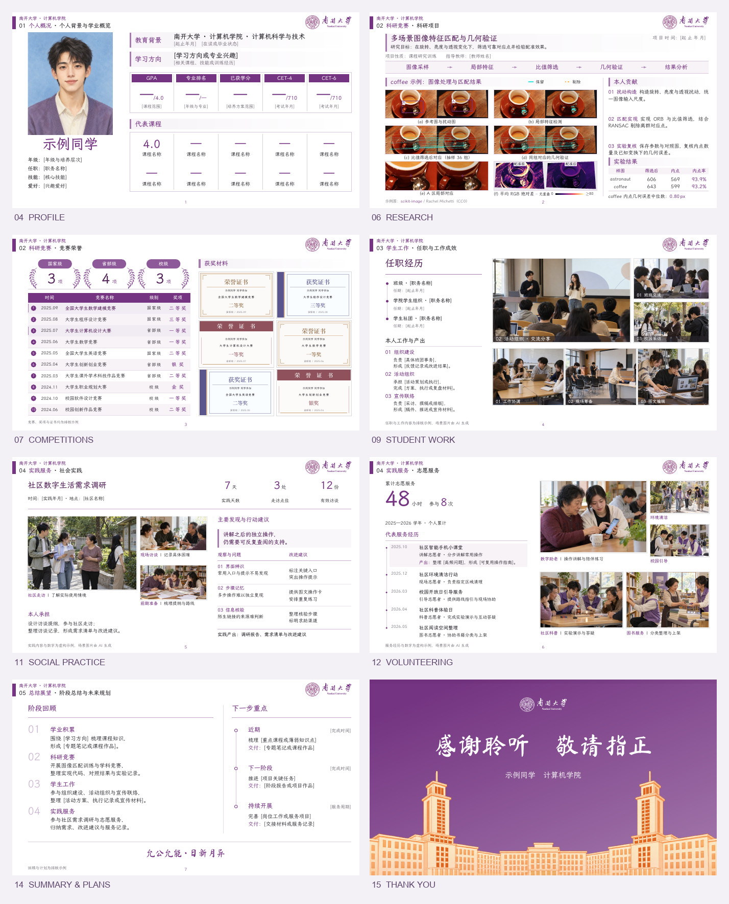

# Scholarship Beamer

一套用于奖学金答辩、评优展示的中文 LaTeX Beamer 模板，也可以按需要改成保研、夏令营的自我介绍。

[下载源码](https://github.com/eprogressing/scholarship-beamer/releases/latest/download/scholarship-beamer-overleaf.zip) · [查看 PDF](https://github.com/eprogressing/scholarship-beamer/releases/latest/download/scholarship-beamer.pdf) · [Prism 使用教程](#用-prism-在线修改) · [换校教程](CUSTOMIZE.md)

**免费开源，推荐用 Prism 在线修改、编译，不用安装软件。** 16:9 画幅，共 15 页，正文使用霞鹜文楷。


下载包默认附**南开版**，其他三校是换校效果展示。可以自行替换学校配色、校徽和建筑，具体见[换校教程](CUSTOMIZE.md)。这是个人制作的非官方模板。



## 用 Prism 在线修改

Beamer 用 LaTeX 制作幻灯片：在源码里改文字和图片，编译成 PDF。[Prism](https://prism.openai.com/) 是 OpenAI 提供的[免费 LaTeX 工作区](https://openai.com/prism/)，可以直接导入这套模板。

1. 下载上方的源码 ZIP，**不必解压**。
2. 登录 Prism，点击 **「导入 → 导入归档文件」**，选择 `scholarship-beamer-overleaf.zip`。
3. 等待项目创建，打开 **`main.tex`**，点击 **「编译」**。第一行已指定 XeLaTeX，请保留。
4. 修改 `settings.tex` 和 `examples/` 中的内容，重新编译，再点击 **「下载 PDF」**。

完整 15 页已在 Prism 实测通过。如果首次提示“无法加载 PDF”，点击「重新编译」再试。

## 从哪里改

| 要改的内容 | 文件或说明 |
| --- | --- |
| 姓名、学院、专业、题目、日期、学校配色 | [settings.tex](settings.tex) |
| 目录、章节顺序与删页 | [examples/content.tex](examples/content.tex) |
| 个人介绍、科研、竞赛、学生工作、实践服务、总结 | [逐页填写指南](CONTENT_GUIDE.md) |
| 校徽、建筑和学校名称 | [换校教程](CUSTOMIZE.md) |

示例人物、成绩、经历和 AI 场景图用于展示排版，请换成本人的真实材料。科研样图也不代表使用者的研究成果。

## 其他编译方式

<details>
<summary>TeXPage：免费账号已实测通过</summary>

1. 登录 [TeXPage](https://www.texpage.com/console)，点击「新建 → 上传项目」，上传同一份源码 ZIP。
2. 打开项目，在「设置 → 编译设置」中确认 **XeLaTeX、TeX Live 2026、main.tex、常规模式**。
3. 点击「编译」，在 PDF 工具栏的下载菜单中选择「下载 PDF」。

完整 15 页已在免费账号编译通过；当前免费编译时限为 [30 秒](https://www.texpage.com/zh/pricing)。添加内容后如果超时，可改用本地编译。

</details>

<details>
<summary>本地编译：TeX Live / MacTeX</summary>

安装 [TeX Live](https://tug.org/texlive/)（Windows / Linux）或 [MacTeX](https://tug.org/mactex/)（macOS），需要 XeLaTeX 和 latexmk。字体已随项目提供，无需单独安装。

解压 ZIP，在含 `main.tex` 的目录打开终端，运行：

```sh
latexmk -xelatex -interaction=nonstopmode -halt-on-error main.tex
```

生成 `main.pdf`。若还想检查缺字、溢出和字体警告，可运行 `python3 scripts/build.py`（需 Python 3.9+），结果在 `build/main/main.pdf`。本地已在 TeX Live 2026 下测试。

</details>

<details>
<summary>Overleaf：可以导入，免费账号会超时</summary>

[](https://www.overleaf.com/docs?snip_uri=https%3A%2F%2Fgithub.com%2Feprogressing%2Fscholarship-beamer%2Freleases%2Flatest%2Fdownload%2Fscholarship-beamer-overleaf.zip&engine=xelatex&main_document=main.tex)

按钮会导入源码并指定 XeLaTeX、`main.tex`。当前完整示例在免费账号实测超时，付费账号尚未测试；优先使用 Prism、TeXPage 或本地编译。时限见 [Overleaf 官方说明](https://docs.overleaf.com/getting-started/free-and-premium-plans/plan-limits)。

</details>

## 让 AI 帮忙改

在线可以用 Prism 的内置助手；本地可以用 [Codex](https://learn.chatgpt.com/docs/codex/cli)、[Claude Code](https://code.claude.com/docs/en/overview) 等能读写项目、运行编译的 Agent。先改一两页，看到 PDF 后再继续。可以这样说：

```text
请先读 README.md、settings.tex 和 examples/content.tex。
保留现有版式和字体，按我的材料修改封面及第[页码]页。
文字材料：[填写]；照片路径：assets/[文件名]。
缺少的成绩、经历和图片请问我，不要编造。
修改后用 XeLaTeX 编译，检查对应 PDF 页面；无法编译或查看时请说明。
```

AI 服务的使用额度和收费以工具本身为准，使用模板不需要购买 AI 服务。

## 导出为 PPTX

模板编译得到 **PDF**，不是可以在 PowerPoint 中直接改字的 PPTX。需要交 PPT 时，建议：

**PDF → 每页导出高清 PNG → 按顺序放入 16:9 空白幻灯片 → 保存为 PPTX**

图片长边建议至少 1920 像素；转换后文字不能逐字编辑，改稿仍回到 LaTeX。操作见 [PDF 转 PPT](PDF_TO_PPT.md)。

## 许可与致谢

代码和文档使用 [MIT 许可](LICENSE)，字体遵循各自的 OFL 许可。建筑、校徽、示例图片和联系二维码的权利范围见 [素材说明](ASSETS.md) 与 [署名及来源](CREDITS.md)，不能把所有图片都当作 MIT 素材。

制作时参考了 [TemplateNKU](https://github.com/GrokCV/TemplateNKU) 等项目，感谢[霞鹜文楷](https://github.com/lxgw/LxgwWenKai)等字体项目。问题与建议可以提交到 [Issues](https://github.com/eprogressing/scholarship-beamer/issues)。

## 定制与联系

**源码免费开源，不需要加微信领取。** 不会用，或者想省点时间，可以找我做排版、换校或封面定制，按需求报价。添加时备注「PPT 定制」，带上学校、用途、截止时间和已有材料。


